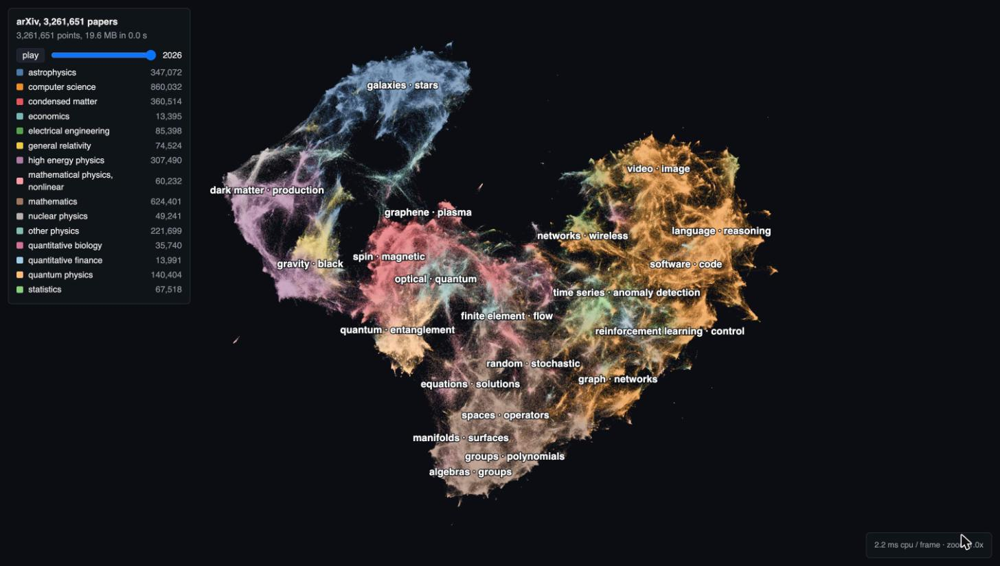
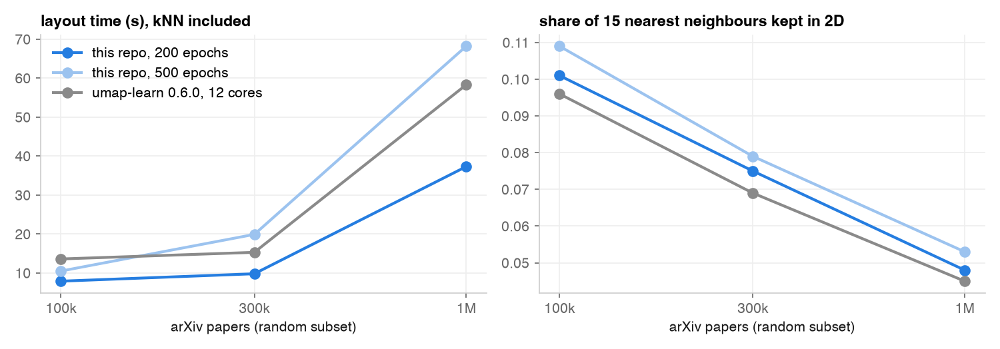
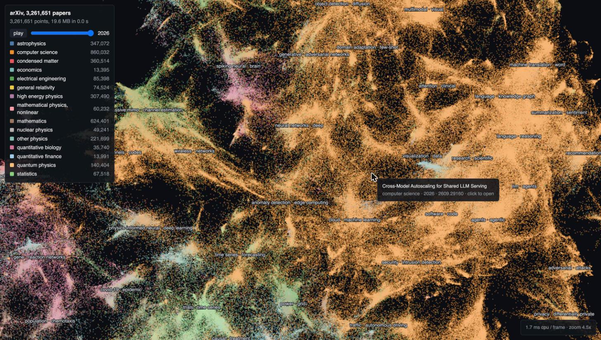
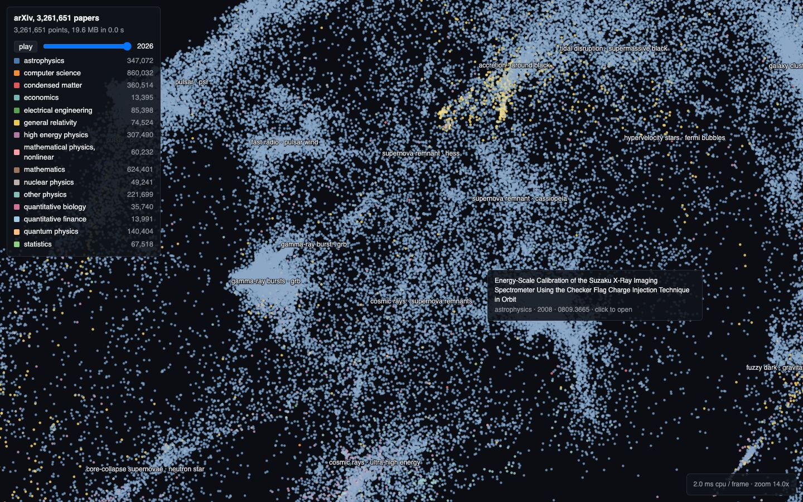
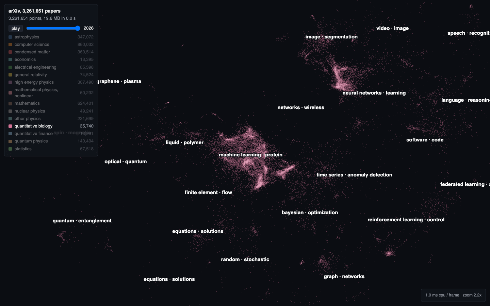
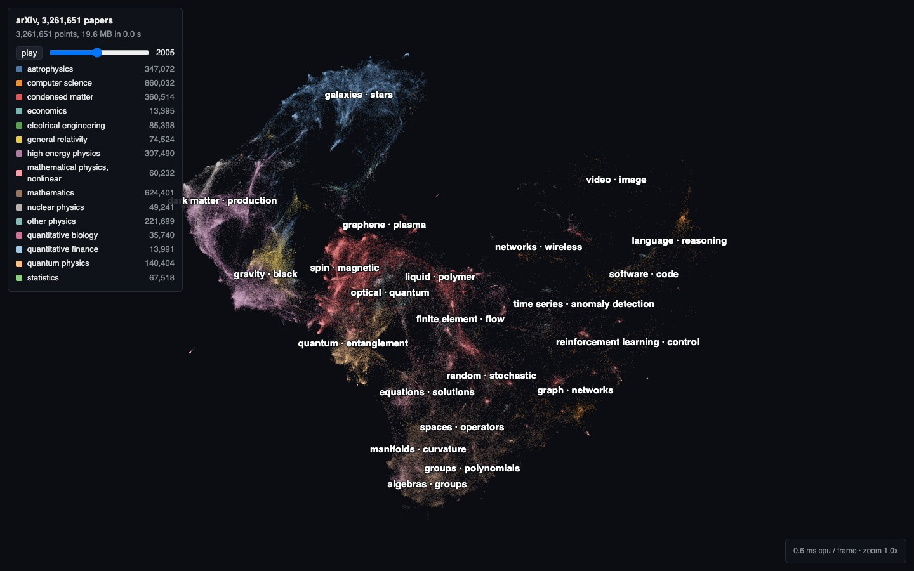

# embedding-map

All 3,261,651 arXiv papers (1986 to 2026) as one zoomable map in the browser. Each paper is placed by what its title and abstract say, so fields, subfields and the bridges between them show up as regions you can fly through. Hover a point for its title, click it to open the paper.



The pipeline is written from scratch on PyTorch and WebGL2, and runs on one laptop (Apple M4 Pro, 24 GB):

| stage | how | time, 3.26M papers |
|---|---|---|
| embed | all-MiniLM-L6-v2, 384 dims, on the GPU | 49 min (cached after) |
| 15 nearest neighbours | inverted-file search on the GPU, recall measured | 80 s |
| 2D layout | UMAP, reimplemented as batched GPU SGD, 500 epochs | 168 s |
| labels | k-means at 3 zoom levels, class-based TF-IDF | 156 s |
| export | 6 bytes per point, titles in lazy tiles | 7 s |

From the build log, `results/arxiv_build.json`.

## Results

**Neighbour search.** An exact search over 3.26M points would take hours. The inverted file compares 1.9% of all pairs and finds 86.7% of the true 15 nearest neighbours (recall@15 against exact search, 2,000 random papers). At 1M points, pynndescent as umap-learn calls it finds 92.2% in 22.8 s on 12 cores; the inverted file finds 87.8% in 16.4 s, or 93.5% in 28.3 s with twice the probes.

**Against umap-learn.** Random subsets of the arXiv embeddings, `bench/scale.py`, `results/scale_arxiv.json`. umap-learn 0.6.0 runs on all 12 CPU cores with its JIT compiled beforehand, and uses 200 epochs above 10,000 points, so this repo is also timed at 200. Neighbours kept: of each paper's 15 nearest neighbours in the 384-dim space, the fraction that stay among its 15 nearest in 2D (2,000 random papers). Trustworthiness on 5,000.

| papers | method | time | neighbours kept | trustworthiness |
|---|---|---|---|---|
| 100k | this repo, 200 epochs | 7.9 s | 0.101 | 0.920 |
| 100k | umap-learn | 13.6 s | 0.096 | 0.926 |
| 300k | this repo, 200 epochs | 9.8 s | 0.075 | 0.926 |
| 300k | umap-learn | 15.3 s | 0.069 | 0.927 |
| 1M | this repo, 200 epochs | 37.3 s | 0.048 | 0.933 |
| 1M | this repo, 500 epochs | 68.2 s | 0.053 | 0.935 |
| 1M | umap-learn | 58.3 s | 0.045 | 0.926 |



*The table above as a chart, from `results/scale_arxiv.json`.*

On MNIST (70,000 points, `results/quality_mnist.json`) the layout matches umap-learn: 2D kNN accuracy 0.970 against 0.970, trustworthiness 0.952 against 0.952. There umap-learn with PCA initialisation is faster (3.7 s against 7.8 s), mostly because this repo's neighbour search is exact below 200,000 points.

The first version was slower than umap-learn at every size. How it got faster, and why batched UMAP needs a smaller learning rate than umap-learn's, is in [docs/how-it-works.md](docs/how-it-works.md).

**Rendering** (`results/render_*.json`, Chrome on a 3024 × 1600-1700 canvas, 120 Hz display, 8 s of continuous zoom and pan; the synthetic runs were taken while other jobs held the CPU):

| points | load | median frame | 95th percentile | fps |
|---|---|---|---|---|
| 3.26M (arXiv) | 46 ms | 8.3 ms | 9.1 ms | 120 |
| 3M (synthetic) | 29 ms | 8.3 ms | 9.1 ms | 119.5 |
| 10M (synthetic) | 141 ms | 8.4 ms | 17.4 ms | 95.6 |
| 20M (synthetic) | 240 ms | 8.4 ms | 33.7 ms | 76.2 |





*Astrophysics at 14x zoom, where the finest of the three label levels shows. Hovering a point loads its title from a lazy tile; clicking opens the abstract.*



*Alt-click on a category in the legend shows it alone. The largest group of quantitative biology papers sits under the "machine learning · protein" label, between the physics and machine learning regions, with smaller groups spread elsewhere.*



*The year slider at 2005: only papers up to that year are drawn. Physics and mathematics are already in place; the machine learning half of the map is nearly empty.*

## What was hard

- **Memory at 3.26M on unified memory.** The first full runs died: one with an MPS out-of-memory error, one swapping 11 GB until the Mac had to restart. The live tensors were small; the GPU driver's cache was not. Each IVF cell made distance blocks of a new shape, and the caching allocator kept them all (14 GB at 400k points); the CPU also queued hundreds of cells ahead of the GPU. Fixed shapes plus one sync per cell brought the peak at 1.2M points from 7.5 GB to 4.3 GB at the same speed.
- **Being faster than a 12-core CPU.** The first GPU version lost to umap-learn at every size. The neighbour search spent 90% of its time outside the matrix products: float32 copies, index masks, and `torch.topk`, which is slow along wide rows on MPS. Ranking in float16 and an exact two-stage top-k made it 3.1x faster; drawing random numbers on the GPU halved the layout time.
- **Batched UMAP overshoots.** A point with 30 edges due in one epoch gets 30 pulls computed from the same stale position, which at umap-learn's learning rate cost 3 points of kNN accuracy on MNIST. A rate of 0.25 over 500 epochs matches it.
- **Drawing millions of points honestly.** Alpha blending shows only overdraw. The renderer accumulates colour and density into a float framebuffer and tone-maps it, so dense regions look dense.
- **Labels people can read.** Two-word terms ("black holes") get a boost, terms that repeat a word of one already chosen are skipped ("galaxies · galaxy"), and TeX accents are stripped from titles first.

The full explanation is in [docs/how-it-works.md](docs/how-it-works.md).

## Running it

```
python -m venv .venv && .venv/bin/pip install torch sentence-transformers numpy scikit-learn umap-learn pytest
.venv/bin/python -m pytest -q                     # 19 tests
.venv/bin/python -m atlas.synthetic 3000000 web/data/synthetic
.venv/bin/python -m http.server 8765 -d web       # then open http://127.0.0.1:8765/
```

The arXiv map needs the metadata snapshot (Kaggle dataset `Cornell-University/arxiv`, 1.9 GB zipped):

```
.venv/bin/python -m atlas.build_arxiv --zip path/to/arxiv.zip [--limit 200000]
# open http://127.0.0.1:8765/?data=arxiv
```

Every stage is cached under `data/`, so a rerun after the embeddings exist takes minutes. `?bench=1` runs the render benchmark. `bench/quality.py` and `bench/scale.py` produce the comparison tables.

## Layout

```
atlas/arxiv.py      read the snapshot, strip TeX accents, map categories
atlas/embed.py      sentence embeddings in resumable shards
atlas/knn.py        exact and IVF k nearest neighbours on the GPU
atlas/layout.py     UMAP: fuzzy graph, PCA init, batched SGD
atlas/labels.py     cluster names at three zoom levels
atlas/export.py     binary points, tile-sorted, title tiles
web/atlas.js        WebGL2 renderer, hover grid, filters, labels
```
